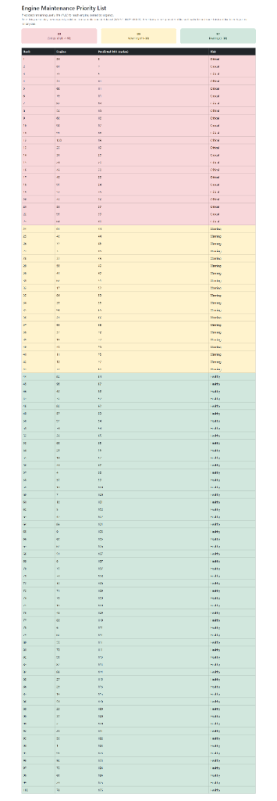
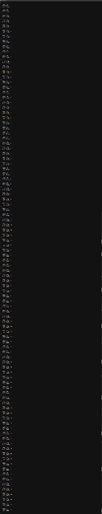

# Engine Maintenance Priority

A predictive maintenance system that estimates the Remaining Useful Life (RUL) of turbofan jet engines and ranks them by maintenance urgency.

This is a personal portfolio project inspired by aviation fleet readiness in defense and aerospace. It uses public simulated data to demonstrate practical machine learning modeling, operational decision thresholds, and a clean web interface for ground crews.

---

## Problem

Aircraft engines operate under extreme thermal and mechanical stress. Traditional maintenance relies on fixed flight-hour intervals, which can lead to:
1. **Premature maintenance**: Removing healthy engines too early, wasting maintenance labor and budget.
2. **Unplanned downtime**: Components failing before the scheduled inspection, causing mission delays or safety hazards.

**Goal:** Predict the Remaining Useful Life (RUL) in flight cycles for each engine in a fleet and prioritize them so maintenance teams know which engines require immediate service.

---

## Data

This project uses the **NASA C-MAPSS (Commercial Modular Aero-Propulsion System Simulation) Turbofan Dataset**, specifically subset **FD001**.

- **Type:** Public, simulated run-to-failure degradation data generated by NASA. It is **not** real military or classified telemetry.
- **Operating Conditions:** Sea level, single operating condition.
- **Fault Mode:** High-Pressure Compressor (HPC) degradation.
- **Fleet Size:** 100 test engines with sensor readings up to an arbitrary point prior to failure.
- **Citation:** Saxena, A., & Goebel, K. (2008). *Turbofan Engine Degradation Simulation Data Set*. NASA Ames Prognostics Data Repository.

---

## Method

The machine learning workflow was conducted offline in a notebook (`defense-project.ipynb`):

1. **Feature Selection & Engineering:**
   - 15 informative sensor channels were retained (constant/uninformative sensors were dropped).
   - 5-cycle rolling averages were calculated for each sensor to smooth noise and capture short-term degradation trends.
2. **RUL Target Clipping:**
   - RUL was capped at **125 cycles**. During initial flight cycles, components show virtually no degradation; capping RUL prevents the model from trying to fit random sensor noise when an engine is new.
3. **Train / Validation Split:**
   - Split by engine ID (80 engines for training, 20 engines for validation). Grouping by engine ensures flight cycles from the same engine never leak into the validation set.
4. **Models Evaluated:**
   - Baseline: Linear Regression
   - Final Model: Random Forest Regressor

---

## Results

### Model Performance

| Model | Validation RMSE (cycles) | Test RMSE (cycles) |
|---|---|---|
| Linear Regression (Baseline) | 19.85 | — |
| **Random Forest Regressor** | **16.61** | **18.53** |

*Note: Validation RMSE was evaluated on 20 validation engines. Test RMSE was evaluated on the final cycle reading of each of the 100 test engines.*

### Operational Cut-off Analysis

In maintenance operations, raw RMSE is less important than catching engines that are close to failure without overwhelming the hangar with false alarms. 

On the 100 test engines, 25 engines were truly critical (True RUL $\le$ 30 cycles). We evaluated different predicted RUL cut-off thresholds:

| Predicted RUL Cut-off | Critical Engines Caught (out of 25) | False Alarms | Recall |
|---|---|---|---|
| Cut-off 30 | 17 / 25 | 1 | 68% |
| **Cut-off 40 (Selected)** | **21 / 25** | **2** | **84%** |
| Cut-off 50 | 23 / 25 | 7 | 92% |
| Cut-off 60 | 23 / 25 | 11 | 92% |

**Why Cut-off 40 was selected:**
- Setting the threshold at 40 catches **21 of the 25 truly critical engines** (84% recall) with only **2 false alarms**.
- Increasing the cut-off to 50 only catches 2 additional engines, but more than triples false alarms from 2 to 7, which would needlessly tie up maintenance crews.

### Fleet Risk Categories

Using the selected thresholds, the test fleet of 100 engines is categorized as follows:
- **Critical (Predicted RUL $\le$ 40):** 23 engines
- **Warning (Predicted RUL 41–80):** 20 engines
- **Healthy (Predicted RUL > 80):** 57 engines

---

## Web App

A lightweight Flask web application displays the precomputed maintenance priority rankings. 

> **Architecture Note:** The web app reads saved predictions from `fleet.csv`. The machine learning model runs offline, keeping the web service simple, fast, and reliable.

### Key Routes:
- `GET /`: Interactive web dashboard built with Bootstrap 5. Displays high-level status summary cards and a ranked priority table.
- `GET /api/fleet`: JSON endpoint returning the prioritized engine records for external systems.

### Screenshots

#### Dashboard Overview (`/`)


#### API Response (`/api/fleet`)


*(Note: If screenshots are not showing, please add `screenshot_dashboard.png` and `screenshot_api.png` to the `images/` directory).*

---

## Project Structure

```text
engine-maintenance-priority/
├── app.py                   # Flask web application
├── fleet.csv                # Precomputed RUL predictions & risk rankings (100 engines)
├── defense-project.ipynb    # Model training and evaluation notebook
├── requirements.txt         # Runtime dependencies (Flask, pandas)
├── requirements-dev.txt     # Development and testing dependencies (pytest)
├── .gitignore               # Git ignore file
├── README.md                # Project documentation
├── templates/
│   └── index.html           # Bootstrap dashboard template
├── tests/
│   └── test_app.py          # Pytest suite verifying data integrity and web routes
└── images/
    ├── screenshot_dashboard.png  # Dashboard UI screenshot
    └── screenshot_api.png        # API response screenshot
```

---

## How to Run

### 1. Set Up Environment

Clone or download the repository, then create and activate a virtual environment:

**Windows (PowerShell):**
```powershell
python -m venv venv
.\venv\Scripts\Activate.ps1
```

**macOS / Linux:**
```bash
python3 -m venv venv
source venv/bin/activate
```

### 2. Install Dependencies

```bash
pip install -r requirements.txt
```

### 3. Start the Web App

```bash
python app.py
```

Open your browser and navigate to:
- Dashboard: [http://127.0.0.1:5000/](http://127.0.0.1:5000/)
- API: [http://127.0.0.1:5000/api/fleet](http://127.0.0.1:5000/api/fleet)

---

## How to Run Tests

Install the development dependencies and run `pytest`:

```bash
pip install -r requirements-dev.txt
pytest
```

All 5 automated tests verify:
1. `fleet.csv` exists, contains 100 rows, and has columns `engine`, `predicted_rul`, `risk`.
2. Risk classifications match defined thresholds ($\le 40$ Critical, $41\text{--}80$ Warning, $> 80$ Healthy).
3. No duplicate engine IDs exist in the dataset.
4. The dashboard route (`/`) returns HTTP 200.
5. The API route (`/api/fleet`) returns HTTP 200 with 100 JSON records.

---

## Limitations

- **Simulated Data:** The dataset is synthetic NASA benchmark data; real military engines operate with complex variable mission profiles, environmental dust/sand, and multiple interacting failure modes.
- **Single Fault Profile:** FD001 models only High-Pressure Compressor wear under steady sea-level conditions.
- **Offline Batch Architecture:** The application displays saved batch predictions rather than ingesting live streaming sensor telemetry.
- **Missed Critical Engines:** At the chosen cut-off of 40 cycles, 4 out of 25 truly critical engines were missed (RUL was overestimated). In a live operational setting, safety margins would require secondary inspection rules.

---

## Future Work

- **Multi-Condition Datasets:** Train on C-MAPSS subsets FD002 and FD004 which include six operational conditions and multiple simultaneous failure modes.
- **Deep Learning Architectures:** Experiment with recurrent neural networks (LSTMs) or 1D-CNNs to model time-series sensor sequences directly without manual rolling averages.
- **Live Inference Endpoint:** Implement a `/predict` endpoint with Pydantic request validation to score incoming telemetry on the fly.
- **Deployment & Containerization:** Package the application using Docker and configure automated CI/CD checks via GitHub Actions.
